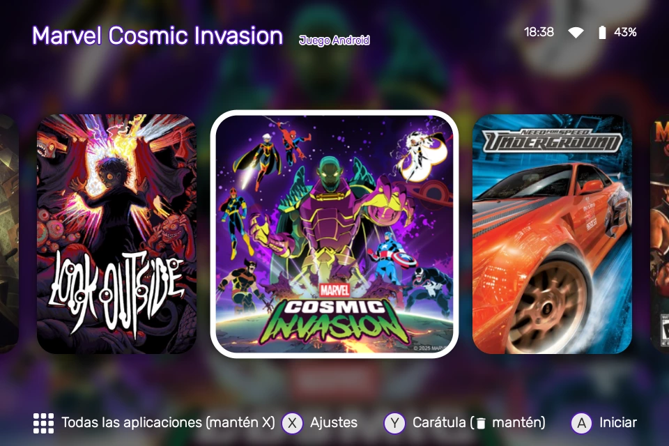
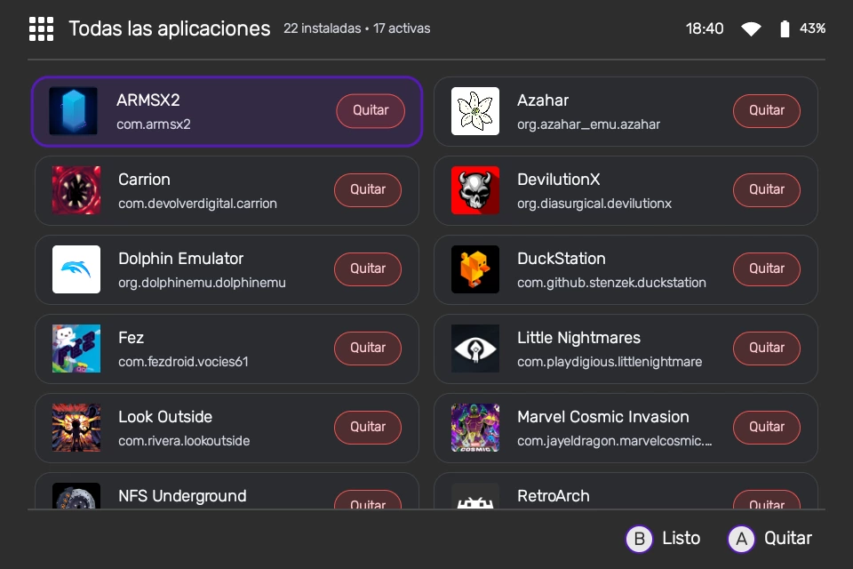
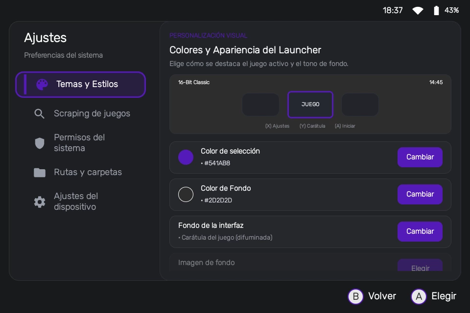

 

 

Android 8+ · 60 FPS · 100% gamepad · Sin root

---

## ✦ Todo lo que necesitas para tu consola portátil

<table>
  <tr>
    <td width="33%" valign="top">
      <h3>▣ Carrusel unificado</h3>
      Juegos nativos de Android y accesos directos a emuladores (PSP, PSX, SNES, RetroArch) en un único carrusel.
    </td>
    <td width="33%" valign="top">
      <h3>▼ Scraper de carátulas</h3>
      Descarga automática de carátulas HD y metadatos con buscador integrado. Adiós a los iconos estirados.
    </td>
    <td width="33%" valign="top">
      <h3>⚡ Kill combo</h3>
      Cierra emuladores o juegos colgados al instante con <b>Start + R1</b>, sin tocar la pantalla.
    </td>
  </tr>
</table>

  
  

- **Organización total:** cuadrícula con todos tus juegos y apps; agrégalos o quítalos del carrusel en un paso.
- **A tu estilo:** mapeo Nintendo, Xbox o PlayStation, selector HSV de color de acento y barra de estado con batería, Wi-Fi y reloj.

## ⬇ Instalación

1. Descarga el APK con el botón **Descargar APK** (o desde [Releases](https://github.com/Vegeta86/titos/releases)).
2. Permite instalar apps desconocidas: *Ajustes → Apps → Acceso especial → Instalar apps desconocidas*.
3. Abre el APK y pulsa «Instalar».
4. Sigue el asistente: idioma, permisos y carpetas de ROMs.
5. Pulsa Inicio en tu consola y ¡a jugar!

## ♥ Apoyo

TITOS es gratis y lo desarrollo en mi tiempo libre. Si te gusta, puedes apoyarlo con una [donación por PayPal](https://paypal.me/tipsjriverac). ¡Gracias!
